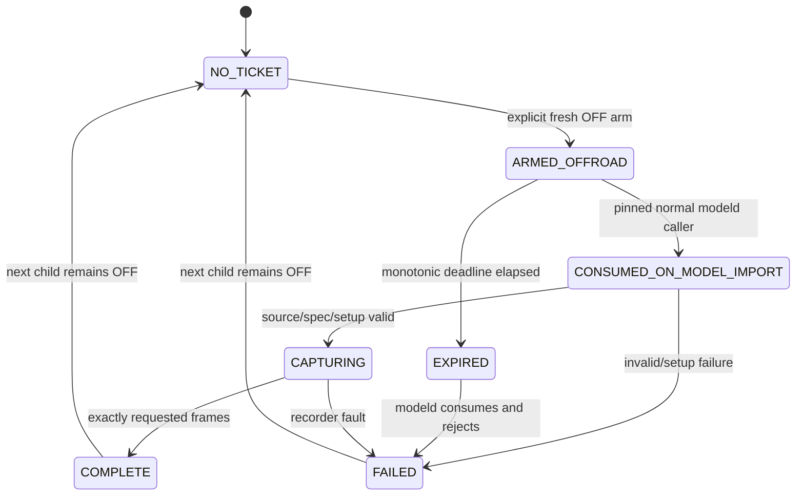

# M19-B0 — activation and launch review, offline only

2026-10-24. **RECOMMEND_B / activation candidate PASS — CPU_FAKE, FIXTURE.**
No actual comma or Jetson connection was made. The last attested actual state is
M19-A **PATCH_LEFT_INSTALLED_OFF**, carrot-nav
`366d6eae9aa9962104391e1d997fe956dea8f64d`, recorder OFF, no ticket/activation/capture.
There is no fresh actual-device preservation claim in this offline stage.
Numerical decision remains **PARITY_UNDETERMINED / M2 NO**.

The candidate changes two files in the installed M19-A profile: the model module's
activation footer and the recorder hook. No manager, process policy, launcher,
JoiningModel logic, Warp, inference, fallback, selection, controls or protocol logic
is changed. Actual deployment is **NOT_RUN**. A later deployment must use the delta
below, not reapply M18.

Evidence: [choreography](../artifacts/m19b0_activation_choreography_20261024.json),
[profiles and validation](../artifacts/m19b0_activation_v2_validation_20261024.json).

## Exact source review

All eleven source files were read from local Git objects at exact366. Their full
SHA256 values are in the choreography artifact. Latest Nav/WIP are separate refs;
no rebase, pull or replacement of this target was performed.

| Boundary | Exact366 source evidence | Result |
|---|---|---|
| OFF/onroad policy | process_config.py: only_onroad; modeld and card registrations | Both require started; OFF provides neither live carState nor model inputs |
| Camera policy | process_config.py: driverview | started or existing DriverView policy, unchanged |
| Manager preparation | manager.py manager_init, lines140–141 | Calls each p.prepare() |
| Python preparation | process.py PythonProcess.prepare, line192 | importlib.import_module(self.module), does not call main |
| Normal child | PythonProcess.start, lines185 and210 | Process unless spawn=True; modeld registration does not request spawn |
| Child launcher | process.py launcher, lines26–38 | Import module, rename/reset child messaging, then mod.main() |
| Model wrapper | modeld.py main, line359 | Lazy JoiningModel import after camera/internal model startup, in the non-USBGPU AGNOS branch |
| Competing import | jetlink/prepare.py main, line72 | A separate Warp preparation interpreter imports the same jetlink.model module |
| Volatile convention | system/hardware/hw.py Paths.shm_path | Linux /dev/shm; existing Jetlink socket/status/lock paths use it too |

In the reviewed source, the runtime imports of jetlink.model are in modeld.main
and prepare.main; the other direct import is a test. Modeld module-level imports
do not directly import it. The prepare helper is invoked in its own interpreter,
not by manager's modeld preimport. No global start-method override was found in
the scoped runtime source; Linux Python3.12's default fork was also exercised in
fixtures. The tinygrad training example that selects spawn is not a runtime import.

The source-backed fork fixture executes the exact manager prepare-loop node,
PythonProcess, launcher and ensure_running definitions. It loads modeld's original
module imports/definitions with inert native dependencies, reducing main to its
exact JoiningModel import statement. Thus **manager preimport does not consume**
in the reviewed path. This is not execution of full manager_init, full modeld,
camera/GPU bootstrap or inspection of the live manager module table. If some other
custom runtime path has already cached the target in manager, a later child may
produce zero capture frames; do not force a process/import to bypass that condition.

## A — launch environment inheritance: RISKY

The source inheritance chain is valid:

`explicit launch env → launch_openpilot.sh exec → launch_chffrplus.sh →
start_manager → manager.py → multiprocessing fork → launcher → modeld.main →
lazy jetlink.model import`.

launch_openpilot.sh execs launch_chffrplus.sh. Its sourced launch_env.sh exports
runtime settings without unsetting the capture variable. The start_manager shell
function runs manager.py, through taskset on AGNOS; the pipeline used for startup
logging preserves exported environment. Manager adds its own fields and forks
modeld without removing the capture variable. A shell export after manager has
started cannot modify that parent's environment. Fork fixtures distinguish an
inherited variable from an export made only in a separate shell.

This valid inheritance is not a safe pinned restart recipe. **restart.sh is
RESTART_SH_UNSUITABLE_FOR_PINNED_CAPTURE**: after setup it performs `git pull`,
stops the external Carrot web watchdog/server, can escalate termination, removes
its PID file, kills/recreates the comma tmux session and relaunches openpilot.
It is not used or modified here.

launch_chffrplus.sh also has substantial conditional side effects: finalized overlay
checkout swaps/re-exec; pythonpath/pydeps setup; recovery/SSH setup; AGNOS init;
dependency bootstrap, with local wheels and possible package-index fallback;
SCons/cache/rebuild handling; external Carrot web lifecycle; optional eGPU model
preparation; native/model build checks and background update checks. A working-tree
patch alone does not prove its Git-metadata-based overlay check will block a swap.
None of these branches was executed in this review.

manager_init clears CLEAR_ON_MANAGER_START, onroad/offroad-transition and
ignition flags, applies defaults and performs normal registration/setup. Its
environment logging also includes inherited capture paths. Jetlinkd follows the
manager lifecycle; external web/recovery and some daemon processes can outlive it.
Relaunch delay, builds and human ignition timing consume the ticket's maximum300s
budget before modeld reaches its lazy import.

After capture, A leaves the consumed ticket path in manager and potentially other
launcher descendants. A later modeld fork tries the old path; existing consumption
markers/ID claims make it fail recorder-only, without selecting another model or
starting another valid capture. Nevertheless the stale environment remains. To
remove it completely requires a separately reviewed clean relaunch of the owning
launch/manager lineage and any surviving inheriting services, plus inspection of
tmux environment. Merely unsetting a terminal variable or restarting one modeld
child cannot clean its parent. No approved exact366 no-update recipe was established
for that larger operation, and none is proposed as an executable command here.

There is an additional issue: an always-run Jetlink daemon can invoke the Warp
preparation subprocess. M18's unguarded env footer can consume A's ticket there
before modeld. The fixture reproduces this. A would require actor isolation too;
environment inheritance by itself is insufficient.

## B — volatile ticket discovery: selected offline candidate

The proposed fixed path is **/dev/shm/carrot-v3-input-capture/arm.ticket**. This is
a public design constant, not a disclosed actual private capture path. Actual366's
shm convention supports choosing it; deployment must freshly verify the real
mount, ownership, permissions and absence/collision state before any arming.
No directory or ticket was created on actual comma in M19-B0.

The generated footer performs one lstat at lazy module import. With no ticket it
catches the discovery exception and does nothing: no capture-package import,
Recorder instance, writer, shared ring, input copy or frame-path check. With an
entry it imports install_discovered; all setup exceptions remain recorder-only.
The old environment selector cannot activate this footer. No persistent Param,
setting, service environment or manager modification is introduced.

**Discovery alone is insufficient because of the Warp helper.** Before consumption,
the hook requires both active frames from the normal call chain:

- openpilot.system.manager.process.launcher;
- openpilot.selfdrive.modeld.modeld.main.

It checks each frame's function-code identity, exact source filename and pinned
file SHA256, bounded to64 frames. No process-title/env label is treated as proof.
The helper and manager preparation cannot consume the ticket. The extra source
pins are process.py `fa18404d…` and modeld.py `008b225d…`; full hashes are in the
artifact and generated hook. They are additional future deployment gates.
This check runs only during ticket-present import/setup, never per frame. It is
not authentication against an actor able to rewrite same-UID source/code.

Only the generated install API gains an explicit arm_path parameter, allowing the
fixed-path wrapper to reuse the existing implementation without changing parent
environment. The legacy explicit API is retained for regression compatibility;
the new footer calls only install_discovered. Existing observer functions/classes,
ticket format, infer return/exception behavior and data writer are frozen.

### Filesystem and ticket contract

Arming still requires a fresh, externally verified genuine OFF assertion. The
helper does not query/change Params and modeld consumption intentionally does not
require OFF; normal modeld is already onroad when it consumes.

The production guard requires absolute /dev/shm, a root-owned1777 directory and an
exact tmpfs mount from mountinfo. The private child directory must be owned by the
effective UID/GID with mode0700, and the ticket must be regular, single-link,
owner/group matching, mode0600 and non-symlink. No FIFO is opened blocking.
Directory and path components reject symlinks. Consumption also checks ticket
inode identity across the existing consume operation. The private-directory threat
model excludes a malicious same-UID actor who can already rewrite runtime source;
it does not claim atomic whole-filesystem or hostile same-UID protection.

Existing arm_ticket creates the exact same schema1 ticket with O_EXCL/O_NOFOLLOW.
Existing consume_ticket retains a .consumed hard link, removes the original path,
validates canonical JSON, boot ID, monotonic expiry, source/spec/path binding and
claims the exclusive capture ID. No second weaker ticket format exists. The
source/spec gate still applies to the actual existing V2/Nav nonstate client;
V3/Protocol3 is not selected or enabled.

Unsafe ownership/mode/symlink/FIFO entries are left untouched and cannot activate.
Owned regular malformed, expired or wrong-boot tickets are consumed and rejected;
the original name is gone. Source gate failure after consume is also terminal.
An invalid caller/source-context guard leaves the ticket untouched and recording
OFF; it cannot bypass the role check by waiting or changing environment.
No failure affects normal model startup, inference result or original exception.

### Lifecycle and cleanup



There is no automatic transition back to ARMED. A normal process restart or next
ignition cycle sees no original ticket. Retained .consumed and capture-ID claims
prevent reusing/copying its content. arm_discovered refuses a prior consumed marker;
it never removes it to make arming pass. Volatile markers disappear at reboot;
the boot binding rejects old content even if copied back. Unsafe stale entries or
prior markers require explicit safe-state operator review/cleanup of exact private
ticket paths, never a blanket directory purge or route/source cleanup. No such
cleanup is executed here. Successful capture removes activation authority before
its first frame; the writer can finish independently. B needs no cleanup restart
to remove a parent environment variable because none is injected.

The existing maximum remains300s, default60s. Manager is already ready under B, so
launcher/build delay is removed. Human ignition delay and camera/internal model
startup still consume the budget. This is conditionally practical, not a measured
guarantee that every startup finishes in300s. Arm immediately before the separately
approved natural transition, verify sufficient ordinary readiness, and let expiry
fail closed. Do not extend the maximum, fake OFF or rearm onroad to hide a slow
startup. Return through a genuine OFF transition before a new explicit decision.

## Comparison

| Criterion | A: launch environment | B: volatile ticket + role guard |
|---|---|---|
| New production code | Existing env API0 new files; helper isolation still needed | Two existing recorder targets, no new target module |
| Manager restart | Relaunch to inject; another cleanup relaunch | None for normal fresh modeld child |
| Launcher/bootstrap side effects | Conditional overlay/update/build/dependency/Params/web effects | None introduced |
| Ticket expiry pressure | Launcher + manager + modeld + human timing | Human transition + ordinary modeld startup |
| Human timing sensitivity | Larger variable startup window | Smaller, still bounded300s |
| Capture persistence risk | Parent/descendant env survives consume | Original ticket gone; no env/config toggle |
| Cleanup requirement | Consumed claims + inherited-env lineage | Explicit volatile marker review, no restart |
| Default-OFF overhead | Existing getenv at import | One lstat at import; no per-frame check |
| Rollback complexity | Environment/process lifecycle plus any source guard | Exact two-file reverse delta to M19-A |
| Onroad runtime risk | Unreviewed full relaunch and helper misconsume | Startup-only recorder boundary; hardware capture remains untested |
| Existing source modifications | No manager changes acceptable; launch control unresolved | Only footer/hook; normal policy unchanged |

**A RISKY; B SAFE as an offline candidate, conditional on future device gates.**
The supported workflow has the manager remain OFF and already ready while arming;
normal ignition then starts its own processes. No manual card/modeld/camerad, fake
ignition, selection change, launcher edit or restart.sh is used.

## Three profiles, patches and rollback

The original M18 patch remains byte-identical at SHA
`3a3e19430ab667d204f22fd1e40438a85e1ade1dbab2e6f9dd6e3dd32de4c1ee`.
recording/hook.py and other M18 modules are unchanged; the offline adapter generates
the revision. It refuses a changed M18 source or six-file M19-A profile.

- [Forward activation delta](../patches/carrot-nav-v3-input-recorder-activation-v2.patch):
  `ea18f2c2849e09e577882599a6374c13d09779ebbef5909d2d73934ed41ad6cb`.
- [Reverse activation delta](../patches/carrot-nav-v3-input-recorder-activation-v2.reverse.patch):
  `0593e4a283d3ceec85c37367d0a3776ba0c80340ac857122bfe90f37ee36cf4a`.

| Profile | model.py SHA256 | hook.py SHA256 |
|---|---|---|
| Original366 | c627644ff2f986883325aaca1b8410f216f45447c6595a123d8c1e53ef8c83da | ABSENT |
| Installed M19-A | 4813e215b13b447a234ca78839d4cac605f69a9ec2b1a6263ed9ffa063204f0d | e8196e46df04a0ca99dd1ba4d009d5a683bd8e8a7a91b05a8b81bec3731f5bd1 |
| Candidate activation-v2 | 0fbcba80a84fa6ffd22a6463cb75f111c95cd939697ce357e44ec45909109c91 | 9e688299d4fcefeea3a5ebc1460ee8fd72afd1c15c9f2d1a1fd3f58b1a5ca7de |

The other four package files are identical to M19-A. In disposable fixtures,
original366→M18→delta produced exact candidate hashes; reverse delta restored all
six M19-A bytes; reverse M18 restored original366 and five-module absence.
No actual rollback or patch deployment was performed. Future deployment must
attest original48 by their private identities plus exact M19-A six, apply only the
delta, then retain a distinct reviewed v2 POST profile. Do not reinterpret the
old baseline or compare new recorder metadata to the old full POST digest.
U32 remains accepted only for scoped isolation, never declared unused; the new
reviewed delta and namespace boundaries must be included in the future attestation.

## CPU validation and overhead

**310 unique PASS / 0 FAIL / 0 SKIP**, 72.40s: new activation52 + unchanged
M18/checker/layout/provenance regression258. Seven real Linux fork scenarios cover
B normal/helper-first/failure/context-source-drift, A inherited/shell-only/helper-first,
manager preimport and second-child behavior. Native dependencies and reduced main
are explicitly fixtures; full vehicle/runtime startup is not certified.

Security/lifecycle coverage includes OFF, external OFF assertion, expiry cap,
boot/expired/malformed/duplicate/moved/oversize tickets, symlink/FIFO/hardlink,
mode/UID/GID/directory/mount failure, concurrent consume, copied capture-ID denial,
source/spec drift, output/writer faults and unchanged infer exception/result.
An actual host writer subprocess completed10 **synthetic fixture** records, and the
strict Dataset reader verified logical bytes, scalar bits and COMPLETE. This is
not COMMA_REAL_CAPTURE, recorded driving input or model inference.

```sh
PYTHONPATH=. PYTHONDONTWRITEBYTECODE=1 OPENBLAS_NUM_THREADS=1 python -m pytest -q -p no:cacheprovider tests/test_recorder_activation_v2.py tests/test_u32_provenance.py tests/test_comma_dirty_baseline.py tests/test_comma_dirty_layout.py tests/test_v3_input_format.py tests/test_v3_input_recorder.py tests/test_v3_input_dataset.py tests/test_v3_input_hook.py --tb=short
```

CPU_HOST_BENCH:5000 missing-ticket footer executions on host Linux/WSL tmpfs,
200 warmup: p50 **1.988µs**, p95 **2.4891µs**, p99 **3.30512µs**, max **48.101µs**.
This is one import-time check, not per-frame work or actual comma performance.
No threshold or real-time acceptance is inferred. No capture package was imported,
Recorder instantiated or tensor copied by the missing-ticket footer.

RED failures were observed before implementation: missing adapter, wrong helper
consumption and unexpected lstat exception escaping import. Each was corrected and
the final full suite passed. An initial Windows generator invocation rejected
reference symlink-status differences before writing output; the clean WSL source
was used without deleting anything or weakening that gate.

One independent final read-only local review found no Critical, Important or Minor
issues. It confirmed profile/patch/source pins and the310-case JUnit scope without
rerunning tests, contacting devices/network, deploying or editing files.

## Next deployment boundary

**Ready for activation-delta deployment: YES, with fresh actual preflight and
separate authorization. Ready for M19-B vehicle10: NO.** The actual recorder still
has the M19-A env footer; this candidate is not installed.

The next stage should deploy only this delta while detached/OFF: fresh exact366,
original48/M19-A POST and source hashes; explicit new context pins; dependency/U32
isolation; boot-local mount/owner/collision capability checks; disposable forward/
reverse; private backup of the two changed files; exact after hashes and OFF health;
record new POST. No ticket/activation/capture in that deployment stage. No manager
restart is required by this mechanism's normal policy path.

Activation occurs automatically inside modeld startup and can precede an external
stationary check. B0 does not prove a live stationary gate before the first copied
frame. A future vehicle plan must keep the vehicle physically stopped throughout,
start read-only live telemetry observation before the normal transition, and
validate stationary coverage across the capture timestamps before accepting a
dataset. Unknown/moving intervals must be rejected; no cached/default carState
counts as proof. This timing/abort plan is another reason capture readiness is NO.

Only after that separately completes may a separately approved vehicle10 plan use
the existing Nav/V2 **Protocol2** Jetson configuration, read genuine OFF/source/spec
proof, arm10/depth4 once, transition by normal ignition, verify live vEgo/standstill,
observe10 exact tuples, validate COMPLETE and stop. Tuple availability still depends
on the already selected nonstate Jetlink path. Missing tuple or expired ticket is a
stop, never a reason to enable V3/P3 or force another process. No road capture follows
automatically. Current M1 plan remains DO_NOT_INSTALL and M2 remains NO.

Start/end upstream reference checks matched the full HEADs in the artifact. Actual366
was never advanced. Development main and old feature refs remain protected.

Implementation commit: `ef75b447fc66e4a5b526c0b6634d47f5cc4b429b`. The documentation/evidence commit is resolved
with `git log -1 --format=%H -- artifacts/m19b0_activation_choreography_20261024.json`.
